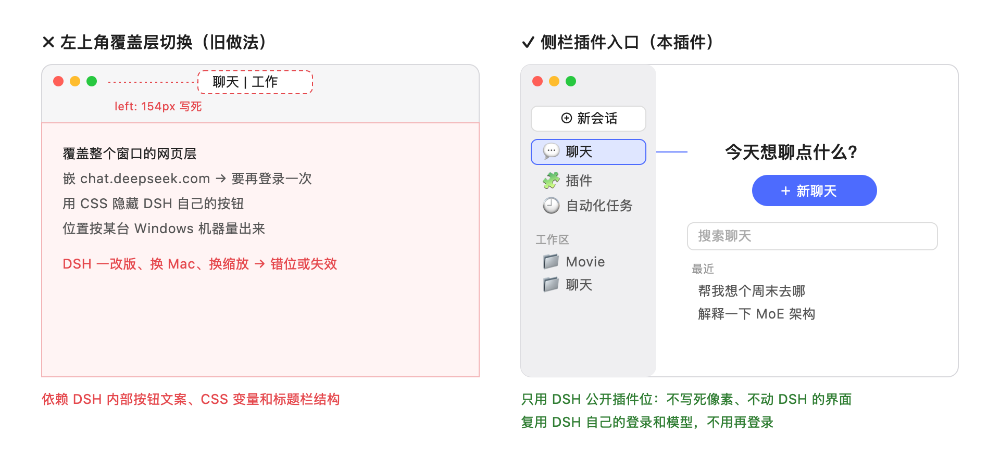

# DSH Chat Mode

[中文](README.md) | English

Adds a **Chat mode** to the [DeepSeek Harness (DSH)](https://www.deepseek.com/en/harness/) desktop app. A **Chat** entry appears in the DSH sidebar, and from there you can just talk, the way you would in Claude's desktop Chat. You don't pick a project first, and you don't sign in a second time.

> Unofficial third-party plugin, not affiliated with DeepSeek.



## What it does

- **A Chat entry in the sidebar.** The panel has a greeting, a **New chat** button, search, and your recent chats.
- **Runs on DSH's own sessions, sign-in and models.** Each chat is an ordinary DSH session. It uses the account you are already signed in with and your default model, and you can switch models in the composer. No embedded web page, no stored tokens.
- **Chats can only do chat things.** Every chat runs on the plugin's `chat` agent preset. The model has three capabilities:
  - search the web and open pages (DSH's `web_search` / `web_fetch`);
  - see the images you send;
  - read the files **you attach to that chat** with `read_attachment`.

  It has no tools to read or write files on your computer, run commands, or start subagents. `read_attachment` is enforced on the DSH Host: it refuses another chat's attachments and any other path, such as `~/Desktop` or `~/.zshrc`.
- **Leaves your projects alone.** Chats live in a dedicated folder, `~/.dsh/chat-mode-workspace/`. That folder shows up as a single "Chat" group, kept last in the workspace list, instead of mixing chats into your project workspaces.
- **Multi-language.**
  - The UI follows DSH's UI language: 中文, English, 日本語, Español, Français, Deutsch, Русский, Português.
  - The chat workspace is named in the system language when it is first created (聊天 / Chat / チャット / Чат).
  - The model replies in the language you write in.
- **Work mode is unchanged.** DSH's own UI and behavior are not touched.

## Why a sidebar panel, not a top-left toggle

The most Claude-like design would put a "Chat | Work" toggle in the top-left corner of the window and lay a full chat screen over DSH. An earlier plugin did exactly that. It ran into the problems below:

| | Top-left overlay toggle | Sidebar panel (this plugin) |
|---|---|---|
| How it attaches | Covers the window and hides DSH's own title-bar buttons with CSS | Uses DSH's public plugin slots `sidebar.panellist` and `main`, the same way DSH's own Scheduled Tasks page does |
| Positioning | Pixel offsets measured on one machine (e.g. `left: 154px`) | Laid out by DSH; no hard-coded pixels |
| New Mac, new scaling, new DSH release | Drifts out of place or stops working | Follows DSH |
| Sign-in | Embeds chat.deepseek.com, which needs a second sign-in and stores the token in plain text | Uses DSH's sign-in |
| Uninstall | Injected styles and saved tokens have to be cleaned up | Slots are withdrawn and the UI returns to normal |

DSH has no public API for replacing the title bar or covering the window. A top-left toggle therefore has to depend on DSH's internal button labels, CSS variables and title-bar structure. None of those are promised to stay the same, and any DSH update can break them.

A sidebar entry uses the place DSH reserves for plugins. DSH's own plugin guidance (`dsh-creation-recommendations`) recommends the same thing: a sidebar entry plus a main-area page, without replacing the sidebar or reading DOM positions. **Stability matters more than looking exactly like Claude.**

The trade-off: when you open a chat, the main area switches back to DSH's native conversation view. DSH 0.2.2-rc.1 has no public API for embedding that view inside a plugin page, so the chat list and the conversation are not shown side by side. In return, the transcript, model picker, attachments and streaming are all DSH's own.

## Install

Requires **DSH desktop 0.2.2-rc.1**. It has only been tested on macOS.

**Recommended:** open **Plugins → Plugin Market** in DSH, search for `dsh-chat-mode`, and install it.

Or from the command line:

```sh
dsh plugin --profile desktop add github:mercurynomercy/dsh-chat-mode
```

Then **fully quit DSH and reopen it**. A Chat entry appears in the sidebar.

> If you installed `@starplume/dsh-chat-mode`, remove it first with `dsh plugin --profile desktop remove @starplume/dsh-chat-mode`. Don't enable both.

## Uninstall

```sh
dsh plugin --profile desktop remove @mercurynomercy/dsh-chat-mode
```

Then fully quit and reopen DSH. Uninstalling **does not delete** your chats. They stay in the "Chat" workspace group and can still be opened in work mode.

Note that the `chat` preset goes away with the plugin. DSH may then open those sessions with its default preset, which gives the model its full set of tools.

## Where attachments are stored

DSH keeps attachments in `~/.dsh/attachments/v1/`: images in `objects/`, other files in `files/`. The plugin does not copy them anywhere.

DSH never deletes attachments on its own, and one file can be shared by several sessions. Don't delete that folder by hand.

## Known limitations

- Only verified on macOS with DSH 0.2.2-rc.1.
- Chats show up as a "Chat" group in the workspace list. DSH has no public way to hide a workspace, so the plugin moves the group to the bottom on every start instead.
- Starting a new session from the "Chat" workspace in the sidebar uses DSH's default preset, not `chat`. Start chats from the **New chat** button in the Chat panel instead.
- Web search needs a DeepSeek account signed in to DSH, or a DeepSeek API key.
- If your model does not support images or tool calls, DSH handles that as usual.

## Development

```sh
npm install
npm test
```

There is no build step. DSH loads `index.js`, `read-attachment.js` and `client.js` directly.

## License

MIT
