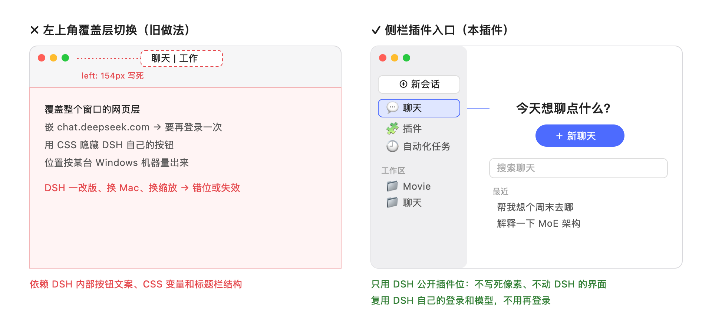

# DSH 聊天模式

中文 | [English](README.en.md)

给 [DeepSeek Harness（DSH）](https://www.deepseek.com/en/harness/) 桌面端加一个**聊天模式**：DSH 侧栏多一个"聊天"入口，点进去就能像 Claude 桌面版的 Chat 那样直接聊天。不用先选项目，也不用再登录一次。

> 非官方第三方插件，与 DeepSeek 官方无关。



## 它做什么

- **侧栏"聊天"入口**：面板里有欢迎语、**新聊天**按钮、搜索框和最近的聊天。
- **用 DSH 自己的会话、登录和模型**：每个聊天都是一个普通的 DSH 会话，用你在 DSH 里已经登录的账号和当前默认模型，在对话框里可以切换模型。不嵌网页，不存任何 token。
- **聊天只能做聊天该做的事**：所有聊天使用插件自带的 `chat` 模式（Agent preset），模型只有三种能力：
  - 联网搜索和打开网页（DSH 自带的 `web_search`、`web_fetch`）；
  - 看你发的图片；
  - 用 `read_attachment` 读你**拖进这个聊天**的文件。

  模型没有任何读写本机文件、执行命令、开子代理的工具。`read_attachment` 由 DSH 那一端强制检查：它只能读本聊天的附件，读其他聊天的附件、`~/Desktop`、`~/.zshrc` 这类路径都会被拒绝。
- **不碰你的项目**：聊天都放在一个专用目录 `~/.dsh/chat-mode-workspace/` 里，在工作区列表里显示为一个"聊天"分组，固定排在最后，不会混进 Movie、CutFinder 这些项目。
- **多语言**：界面跟随 DSH 的界面语言，支持中文、English、日本語、Español、Français、Deutsch、Русский、Português 八种。"聊天"工作区第一次创建时按系统语言命名（聊天 / Chat / チャット / Чат）。模型会用你提问的语言回复。
- **工作模式不变**：DSH 原来的界面和行为一点不动。

## 为什么是侧栏插件入口，而不是左上角切换按钮

最像 Claude 的做法，是在窗口左上角放一个"聊天 | 工作"切换按钮，切到聊天时盖上一整层聊天界面。之前有插件这么做，但用起来有这些问题：

| | 左上角覆盖层切换 | 侧栏插件入口（本插件） |
|---|---|---|
| 怎么挂到 DSH 上 | 在窗口上盖一层，用 CSS 隐藏 DSH 自己的标题栏按钮 | 用 DSH 公开的插件位 `sidebar.panellist` 和 `main`，和 DSH 自带的"自动化任务"同一种方式 |
| 位置 | 按某台机器量出来的像素值（例如 `left: 154px`） | 由 DSH 布局决定，不写死任何像素 |
| 换 Mac、换缩放、DSH 改版 | 容易错位，或者按钮失效 | 跟着 DSH 走 |
| 登录 | 嵌 chat.deepseek.com，要再登录一次，token 明文存本地 | 用 DSH 自己的登录，不用再登录 |
| 卸载 | 要清理注入的样式和保存的 token | 插件位自动撤回，界面恢复原样 |

DSH 没有公开"替换标题栏、盖住整个窗口"的接口，所以左上角方案只能靠它内部的按钮文案、CSS 变量和标题栏结构。这些都不是承诺，DSH 小版本一升级就可能坏。侧栏入口用的是 DSH 官方给插件留的位置（DSH 自带的插件开发建议 `dsh-creation-recommendations` 里也这样推荐：侧栏入口加主区域页面，不替换侧栏、不读 DOM 位置），**稳定比"最像 Claude"更重要**。

代价是：点开一个聊天后，主区域会切回 DSH 原生的对话界面。DSH 0.2.2-rc.1 没有公开接口能把对话界面嵌进插件面板，所以聊天列表不会和对话同时显示。好处是对话、模型切换、附件、流式输出全部是 DSH 原生的。

## 安装

需要 **DSH 桌面端 0.2.2-rc.1**（目前只在 macOS 上测过）。

**推荐**：在 DSH 的 **插件 → 插件市场** 里搜 `dsh-chat-mode` 安装。

也可以用命令行：

```sh
dsh plugin --profile desktop add github:mercurynomercy/dsh-chat-mode
```

本地开发时，把仓库路径加进去即可：`dsh plugin --profile desktop add /path/to/dsh-chat-mode`

装好后**完全退出 DSH 再打开**，侧栏会出现"聊天"。

> 如果你装过 `@starplume/dsh-chat-mode`，请先卸载它：`dsh plugin --profile desktop remove @starplume/dsh-chat-mode`。两个插件不要同时启用。

## 卸载

```sh
dsh plugin --profile desktop remove @mercurynomercy/dsh-chat-mode
```

然后完全退出并重新打开 DSH。卸载**不会删除**你的聊天：它们仍然留在工作区列表的"聊天"分组里，可以在工作模式下继续打开。注意：插件卸载后 `chat` 模式也随之消失，DSH 可能用默认模式打开这些会话，到时模型就会有完整的工具。

## 附件存在哪

附件由 DSH 自己保存在 `~/.dsh/attachments/v1/`，图片在 `objects/`，其他文件在 `files/`。插件不另外复制。DSH 不会自动删除附件，同一个文件也可能被多个会话共用，所以不建议直接删这个目录。

## 已知限制

- 只在 macOS + DSH 0.2.2-rc.1 上验证过。
- 聊天会作为一个"聊天"分组显示在工作区列表里（插件每次启动时把它移到最后）：DSH 没有公开的办法把一个工作区藏起来。
- 从侧栏的"聊天"工作区直接新建会话，会用 DSH 的默认模式，而不是 `chat` 模式。请从"聊天"面板的**新聊天**按钮开始聊天。
- 联网搜索需要你在 DSH 里登录了 DeepSeek 账号，或者配置了 DeepSeek API key。
- 模型本身不支持图片或工具调用时，按 DSH 的提示处理。

## 开发

```sh
npm install
npm test
```

代码不需要构建，DSH 直接加载 `index.js`、`read-attachment.js`、`client.js`。

## 许可证

MIT
